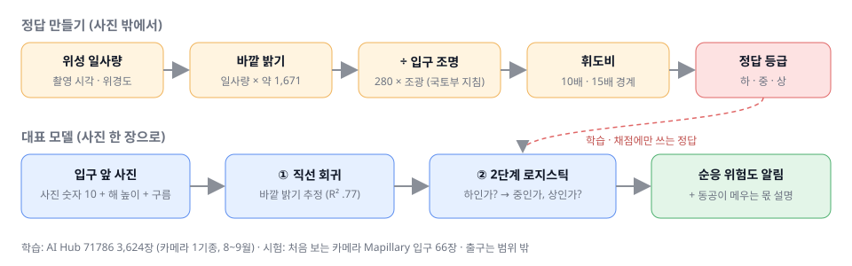
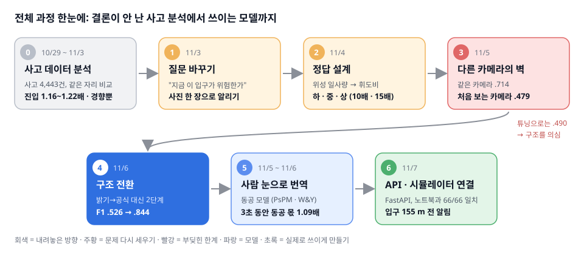
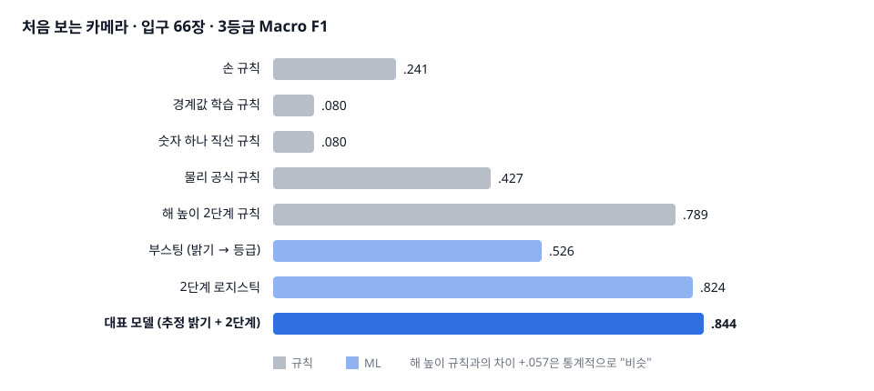
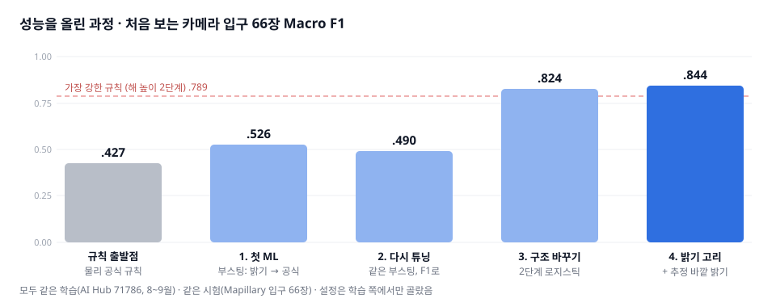
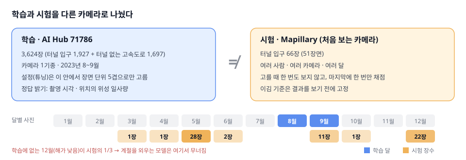
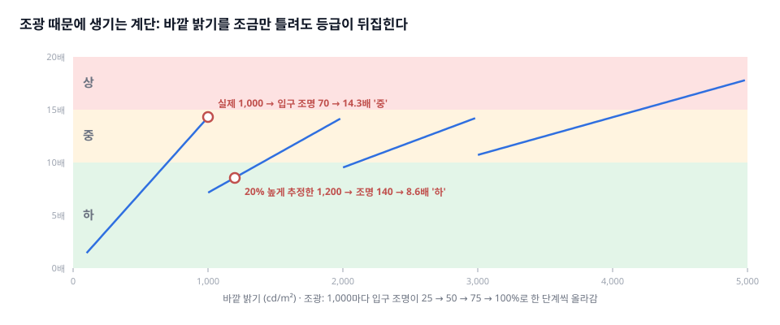
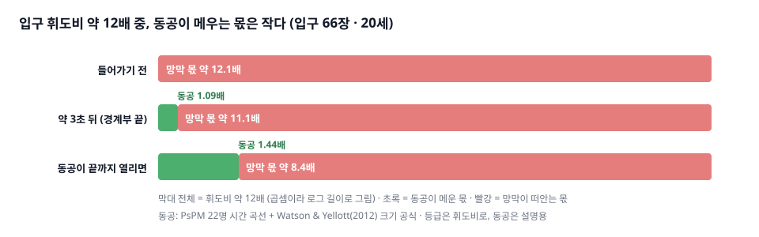

# 터널에 들어서는 3초, 눈은 얼마나 따라갈까

    
 

> iM뱅크 데이터 분석 교육 머신러닝 프로젝트 · 3조 "눈치" · 2026-10-29 ~ 11-10
> **팀 모델 ③ "터널 암순응 위험도" 담당 · 데이터 수집부터 모델 · 동공 모델 · API까지 혼자 맡음**

맑은 날 100 km/h로 터널에 들어서면, 바깥은 터널 입구 안보다 **약 12배** 밝습니다.
입구 경계부 80 m를 지나는 약 3초 동안, 눈동자가 이 차이를 메워 주는 몫은 **1.09배**뿐입니다.
나머지는 망막이 떠안고, 운전자는 그 몇 초를 잘 안 보이는 채로 달립니다.

이 순간을 **입구 앞 사진 한 장으로 미리 알려 줄 수 있을까?**
이 질문에서 시작해, 터널 입구의 순응 위험을 하 · 중 · 상으로 알리는 모델을 처음부터 끝까지 만들었습니다.

> 사고가 어느 자리, 어느 시각에 날지를 맞히는 모델이 아닙니다.
> 햇빛 때문에 순응 부담이 생기는 터널 입구에서, **지금 그 부담이 얼마나 큰지**를 알리는 모델입니다.





📄 발표 자료: [docs/모델3_발표자료_1109.pdf](docs/모델3_발표자료_1109.pdf) · 중간보고(11/2): [docs/SunSight_2팀_중간보고_1102.pdf](docs/SunSight_2팀_중간보고_1102.pdf)

---

## 30초 요약

- **문제:** 터널 입구에서 눈이 어둠에 적응하는 몇 초는 위험하지만, 운전자는 그 위험이 오늘 얼마나 큰지 모릅니다.
- **접근:** 위성 일사량으로 "그 사진을 찍은 순간 바깥이 얼마나 밝았나"를 정답으로 만들고, 사진 한 장으로 그 위험 등급을 맞혔습니다.
- **결과:** 학습에 한 번도 안 쓴 카메라 사진에서 **Macro F1 .844**, 위험 '상'은 하나도 놓치지 않았습니다(재현율 1.00).
- **사람 눈으로:** 공개 동공 데이터로 "3초 안에 동공이 메우는 몫은 1.09배뿐"이라는 설명을 붙였습니다.
- **활용:** 모델을 API로 감싸 팀 운전 시뮬레이터에 연결했습니다. 입구 155 m 전에 등급을 알립니다.



---

## 내 역할

이 저장소의 코드와 분석은 모두 제가 맡은 팀 모델 ③(터널 암순응) 부분입니다.

| 내가 한 것 | 팀원이 한 것 |
|---|---|
| 사고 · 터널 · 기상 · 위성 데이터 수집과 정제, 도로 매칭 | 모델 ① (구간별 사고) |
| 사고 데이터 분석 (같은 자리 비교, case-crossover) | 모델 ② (태양 눈부심 분류) |
| 문제 다시 정의: 사고 예측 → 사진 기반 순응 위험도 | 운전 시뮬레이터 화면 구현 |
| 정답 설계 (위성 일사량 → 바깥 밝기 → 휘도비 → 등급) | |
| 학습 · 시험 사진 수집, 입구/출구 분류 도구 제작 | |
| 규칙 5가지 vs ML 비교, 대표 모델 설계, 공정성 확인 | |
| 동공 모델 (PsPM 시간 곡선, 정상 상태 공식 검증) | |
| 시뮬레이터용 FastAPI (등급 · 동공 · 화면 연출 값 제공) | |

## 성능을 올린 과정: 한계 → 내 생각 → 내 행동



### 0단계. 사고 데이터로는 결론이 안 났다

- **한계:** 고속도로 사고 4,443건으로 "맑은 날 터널 입구가 더 위험한가"를 봤더니 1.16~1.22배였습니다. 95% 범위가 1을 포함했고, 낮 진입 사고가 136건뿐이었습니다.
- **내 생각:** 사고 수는 늘릴 수 없으니, 같은 데이터를 더 파도 결론은 바뀌지 않는다. 그리고 운전자에게 필요한 건 "몇 배"가 아니라 "지금 이 입구가 위험한가"다.
- **내 행동:** 질문을 "사진 한 장으로 지금 입구의 암순응 위험을 알릴 수 있나"로 바꿨습니다. 사고 데이터는 버리지 않고, 등급 경계를 점검하는 데 썼습니다.

### 1단계. 정답을 어디서 가져올까

- **한계:** 정답을 사진에서 계산하면(입구 ÷ 주변 밝기) 모델은 제가 쓴 나눗셈만 다시 배웁니다. 사람이 눈으로 라벨을 붙이면 주관이 섞입니다.
- **내 생각:** 정답은 사진 밖의 물리량이어야 한다.
- **내 행동:** 촬영 시각 · 위치의 천리안 위성 일사량 → 바깥 밝기 → 국토부 지침의 입구 조명 → 휘도비 → 등급으로 정답을 만들었습니다. 처음 쓰던 기상청 관측소 값은 거리가 16.8 km나 되고, 비교 규칙과 같은 관측소 값이라 규칙에 유리해서 위성 값으로 바꿨습니다.

### 2단계. 같은 카메라에선 잘 맞고, 다른 카메라에선 무너졌다

- **한계:** 부스팅 모델은 같은 카메라(71786 안)에서 F1 .714였지만, 처음 보는 카메라(Mapillary)에서는 .479로 떨어졌습니다. 사진만 쓰는 모델은 튜닝할수록 오히려 나빠졌습니다(.524 → .353).
- **내 생각:** 사진 숫자는 바깥 밝기가 아니라 그 카메라의 자동 노출을 외운다. 카메라와 상관없는 값이 필요하다.
- **내 행동:**
  - 해 높이(촬영 시각 · 위치로 계산)와 구름량을 입력에 넣었습니다.
  - 시험은 처음 보는 카메라로만 하고, 설정은 학습 쪽 5겹 검증에서만 고르고, "이김" 기준(짝지은 F1 차이의 95% 아래 끝 > 0)은 결과를 보기 전에 정했습니다.
  - 출구는 학습 사진이 0장이라 빼고, 입구(암순응) 66장으로 판정을 좁혔습니다.
- **결과:** F1 .526. 물리 공식 규칙(.427)과는 통계적으로 "비슷"이었고, '상' 재현율은 오히려 규칙(.966)이 ML(.621)보다 높았습니다.



### 3단계. 튜닝을 더 해 봤지만 떨어졌다

- **한계:** 같은 모델을 F1 기준으로 다시 튜닝하면 .526에서 **.490**으로 떨어졌습니다.
- **내 생각:** 설정 문제가 아니다. 틀린 사진을 직접 봐야 한다.
- **내 행동:** 틀린 사진을 뜯어봤더니 두 가지 원인이 나왔습니다.
  1. 학습은 8~9월뿐인데 시험의 12월 사진 22장 중 6장만 맞혔습니다.
  2. 입구 조명은 바깥 밝기에 따라 4단계로 바뀝니다(조광). 그래서 밝기를 조금만 틀려도 조명 단계가 바뀌어 등급이 뒤집혔습니다. 바깥 밝기 700~1,000은 '중'인데 1,000~1,400은 다시 '하'가 되는 계단 모양입니다.



### 4단계. 구조를 바꿨다

- **내 생각:** 밝기를 맞힌 뒤 공식으로 등급을 내지 말고, 등급 경계를 모델이 직접 긋게 하자.
- **내 행동:** 구조 후보 18개를 같은 조건으로 비교했습니다. "위험한가?"(하 vs 위험) → "얼마나?"(중 vs 상)로 두 번 묻는 2단계 로지스틱을 골랐습니다. "달"을 넣으면 .329로 무너져서 뺐습니다.
- **결과:** F1 **.824**. 12월 사진 22장을 모두 맞혔습니다. 12월의 해 높이(19~27°)는 8~9월 아침 · 저녁 사진에도 있는 높이라, 해 높이로 경계를 그으면 12월도 배운 범위 안에 들어옵니다.

### 5단계. 끊어진 "사진 → 바깥 밝기" 고리를 되살렸다

- **한계:** 등급만 바로 맞히면 바깥 밝기 값이 사라져서, 동공 모델에 넘길 숫자가 없어집니다.
- **내 행동:** 직선 회귀(Ridge)로 바깥 밝기를 추정해 13번째 입력으로 넣었습니다. 학습 사진의 추정 밝기는 자기 정답을 보지 않은 값(5겹 OOF)만 써서, 정답이 새는 길을 막았습니다.
- **내 생각:** 학습 쪽 점수만 보면 부스팅 밝기안이 1등이었습니다. 하지만 새 카메라에서 밝기 R²가 .60이라 직선(.77)을 골랐습니다. 이 판단이 들어갔다는 점은 숨기지 않고 적었습니다.
- **결과:** F1 **.844** (95% 범위 .70~.97), '상' 재현율 1.00, 밝기 R² .77. 이 추정 밝기를 동공 모델에 그대로 넘깁니다.

### 6단계. 이긴 게 맞는지 스스로 의심했다

- **내 행동:** 규칙이 진 게 "틀(구조)" 탓인지 보려고, ML에서 잘 된 구조를 규칙에도 똑같이 줘 봤습니다. 같은 틀에서도 ML이 대체로 앞섰습니다(아래 3-5).
- **한계:** 해 높이 하나만 쓰는 2단계 규칙이 .789로, 대표 모델과 차이(+.057)의 범위가 0을 포함합니다. 12월 · 5월을 뺀 어려운 16장의 정확도는 .69로, 이전 모델과 같습니다.
- **내 생각:** 점수의 큰 몫은 해 높이가 설명한다. "사진이 확실히 낫다"고 말하면 안 된다.
- **내 행동:** 이 내용을 결과와 함께 그대로 적었고, 다음 할 일(겨울 사진 보충, 주행 단위 채점)로 남겼습니다.

## 결과 한눈에 보기

| 항목 | 결과 |
|---|---|
| 대표 모델 | 사진으로 바깥 밝기를 추정한 뒤, 2단계 로지스틱 회귀로 위험도 하 · 중 · 상 |
| 처음 보는 카메라 시험 (입구 66장) | **Macro F1 .844** (95% 범위 .70 ~ .97), '상' 재현율 1.00, 밝기 추정 R² .77 |
| 가장 강한 규칙 (해 높이 2단계) | F1 .789. 대표 모델과 차이는 +.057로 **비슷** (범위가 0을 포함) |
| 물리 공식 규칙 | F1 .427. 대표 모델이 **이김** (+.421, 범위 .22 ~ .61) |
| 사람 눈으로 번역 | 입구 휘도비 약 12배 중, 경계부 끝(약 3초)까지 동공이 메우는 몫은 **1.09배**뿐 |
| 사고와의 연결 | 같은 자리 비교에서 '중' 입구가 '하'보다 1.61배 (p 0.07). **경향이고 확정 아님** |
| 활용 | FastAPI로 감싸 팀 시뮬레이터에 연결. 입구 155 m 전에 등급 알림 |

## 1. 전체 흐름

```
[정답 만들기]  사진의 촬영 시각 · 위경도  (정답 찾기에만 씀)
   └ 천리안 2A 위성 일사량
       └ × 약 1,671  ─► 바깥 밝기(추정, cd/m²)
           └ ÷ 입구 조명 (경계부 280 × 조광 단계) ─► 휘도비 ─► 하 · 중 · 상 (10배 · 15배 경계)

[학습]  사진 숫자 10개 + 해 높이 + 구름
   ─► ① 직선 회귀로 바깥 밝기 추정
   ─► ② 2단계 로지스틱: "하인가, 위험인가" → "중인가, 상인가"

[쓸 때] 입구 앞 사진 한 장 + 휴대폰 시각 · GPS + 날씨
   ─► 위험도 하 · 중 · 상 알림 + "동공은 이만큼만 따라온다" 설명
```

- 정답이 사진 밖(위성)에서 오므로 "사진을 보고 사진을 맞히는" 순환이 아닙니다.
- 천리안은 **정답지**입니다. 학습과 채점에만 쓰고, 운전 중에는 쓰지 않습니다.
- 범위는 **터널 입구(밝은 곳 → 어두운 곳)** 입니다. 출구는 학습 사진이 0장이라 뺐습니다.

---

## 2. 상세: 사고 데이터 분석 (10/29 ~ 11/3)

처음에는 "햇빛이 셀수록 터널 입구 사고가 늘어나는가"를 사고 데이터로 직접 봤습니다.

- 데이터: 한국도로공사 고속도로 사고 4,458건 (분 단위 시각 · 좌표) 중 도로에 올린 4,443건
- 방법: 사고 1건마다 **같은 자리 · 같은 달 · 같은 요일 · 같은 시각의 다른 주** 3~4개와 비교 (case-crossover, 조건부 로지스틱)
- 장소 · 교통량 차이가 지워지고, 그날의 밝기 차이만 남습니다.

| 구간 · 일사량 출처 | 순응 점수 0.1 오를 때 | 읽는 법 |
|---|---|---|
| 터널 진입, 낮, 기상청 ASOS | 1.22배 | 밝을수록 위험한 쪽으로 기우는 경향 |
| 터널 진입, 낮, 천리안 위성 | 1.16배 (95% 0.87 ~ 1.53) | 측정을 바꿔도 결론 같음 |
| 터널 진출, 낮 | 약 0.95배 | 신호 없음 |

**결론:** 효과는 있는 쪽으로 기울지만 작고, 확정할 수 없었습니다.
낮 진입 사고가 약 136건뿐이라 사고 수가 모자랐습니다.
그래서 사고는 등급 경계를 점검하는 **보조 역할**로 돌리고, 질문을 바꿨습니다.

이 단계에서 고친 문제
- **반대 차로 문제:** 사고 1,903건이 반대 차로에 붙던 것을 노선별 방향 규칙표(98행)로 57건까지 줄였습니다.
- **일사량 0 버그:** 일사를 재지 않는 관측소의 빈칸이 0으로 들어가 사고 32%의 점수가 0이었습니다. 일사를 재는 관측소 49곳만 쓰도록 고쳤습니다.
- **관측소가 멀다는 의심:** 관측소 거리 중앙값이 16.8 km라, 천리안 위성 값으로 다시 쟀습니다. 두 값의 상관은 0.896이었고 결론도 같았습니다.

---

## 3. 상세: 사진 기반 암순응 위험도 모델 (11/3 ~ 11/10)

### 3-1. 정답 만들기

| 단계 | 내용 | 근거 |
|---|---|---|
| ① 위성 일사량 | 촬영 시각 · 위경도의 천리안 2A 일사량 (1시간) | 기상청 API허브 |
| ② 바깥 밝기(추정) | 일사량 × 약 1,671 (발광효율 126 lm/W, 노면 반사율 0.15 ÷ π) | 윤갑천 2011, 반사율은 가정 |
| ③ 입구 조명 | 경계부 280 × 조광 단계 (25 · 50 · 75 · 100%) | 국토부 「도로안전시설 설치 및 관리지침 — 조명시설 편」, 280 = 4,000 × 0.07 (100 km/h) |
| ④ 휘도비 | 바깥 ÷ 입구 | |
| ⑤ 등급 | 10배 미만 하 · 10~15배 중 · 15배 초과 상 | Schreuder 1991, TRR 1327. 지침 설계값(약 14배)도 이 사이 |

- 입구 앞 155 m(100 km/h 정지시거)에서 알리고, 경계부는 80 m(지침 그림 6.4 판독)로 봤습니다.
- 터널 입구 조명은 바깥이 밝으면 같이 세집니다(조광). 그래서 바깥 밝기가 크게 변해도 입구 휘도비는 좁은 범위에 머뭅니다. 이것이 입구 등급을 맞히기 어렵게 만드는 이유입니다.

### 3-2. 데이터와 시험 방법

| | 학습 | 시험 |
|---|---|---|
| 데이터 | AI Hub 71786 도로시설물 영상 | Mapillary (여러 사람이 올린 거리 사진) |
| 장수 | 3,624장 (터널 입구 1,927 + 터널 없는 고속도로 1,697) | **입구 66장 (51장면)** |
| 카메라 · 계절 | 카메라 1기종, 2023년 8~9월 | 처음 보는 여러 카메라, 12월 · 5월 · 9월 등 |

- 학습과 시험을 **다른 카메라**로 나눴습니다. 같은 카메라 안에서만 잘 맞는 모델을 걸러내기 위해서입니다.
- 설정(하이퍼파라미터)은 71786 안에서 장면 단위 5겹으로만 골랐고, 시험 사진은 고를 때 보지 않았습니다.
- 사진 숫자 10개: 하늘 밝기, 파란 하늘 비율, 흰 비율, 그림자 대비, 도로 밝기, 하늘/도로 비, 입구 어두움 비, 채도, 밝기 퍼짐, 평균 밝기.
- **이김 기준 (팀 모델 ②와 같음):** 장면 단위로 1,000번 다시 뽑은 F1 차이의 95% 아래 끝이 0보다 크면 이김.

### 3-3. 규칙을 다섯 가지로 만들어 겨뤘다

| 규칙 | 하는 일 | 입구 66장 F1 |
|---|---|---|
| 손 규칙 | 사람이 정한 점수표 (데이터 보기 전에 고정) | .241 |
| 경계값 학습 | 점수표 모양은 같고, 경계만 학습 사진에서 맞춤 | .080 |
| 숫자 하나 직선 | 가장 잘 맞는 사진 숫자 하나로 직선 | .080 |
| 물리 공식 | 맑은 하늘 공식(Haurwitz 1945) × 구름 감쇠(Kasten & Czeplak 1980) | .427 |
| **해 높이 2단계** | 해 높이 35.5° · 51.3°로 하 · 중 · 상 | **.789** |

### 3-4. 대표 모델

```
입력 12개 (사진 숫자 10 + 해 높이 + 구름)
   ─► 직선 회귀 (Ridge, α = 10) ─► 바깥 밝기 추정
   ─► 입력 13개 ─► 1단계: 하인가, 위험(중·상)인가
                 ─► 2단계: 위험이면 중인가, 상인가
```

- 학습 사진의 추정 밝기는 학습 안에서 다시 5겹으로 나눠, 자기 정답을 보지 않은 값만 씁니다 (정답이 새는 길 막기).
- 빈칸은 학습 쪽 중앙값으로 채우고, 표준화한 뒤, 등급 수 차이를 맞추는 가중을 줍니다. 규제 세기 C = 0.01.
- 1단계 가중치는 추정 밝기 .95 > 해 높이 .84 > 구름 −.29 > 파란 하늘 .25 순서입니다. 모델이 추정 밝기를 가장 크게 씁니다.
- 12월은 학습 사진이 없는데도 맞혔습니다. 모델이 계절이 아니라 해 높이와 밝기로 판단하기 때문입니다. 반대로 "달"을 입력에 넣으면 F1이 .329로 무너져서 뺐습니다.

### 3-5. 공정성 확인: 같은 틀을 줘도 규칙은 못 따라왔다

규칙이 진 이유가 "틀(구조)" 때문인지 보려고, 잘 된 구조를 서로 맞바꿔 봤습니다.

| 구조 | 규칙 | ML |
|---|---|---|
| 밝기 → 공식으로 등급 | .427 | .516 |
| 2단계로 등급 바로 | .789 | .824 |
| 추정 밝기 + 2단계 | .581 | **.844** |
| 해 높이 하나만 | .789 | .759 |

- 같은 틀을 줘도 ML이 대체로 앞섭니다.
- 다만 해 높이 하나만 쓰는 쪽은 규칙과 ML이 비슷합니다. **점수의 큰 몫은 해 높이가 설명합니다.**

### 3-6. 처음 본 블랙박스로 검증

- 팀원이 실제 차에서 찍은 블랙박스 영상(학습에 쓰지 않음)으로 밝기 순서를 맞히는지 봤습니다.
- 사진 + 해 높이 + 구름 모델은 밝기 순서를 맞혔고(순위상관 **.70**), 사진만 쓰는 모델은 순서가 거꾸로였습니다(−.49).
- 약점: 비 오는 날 밝기를 크게 봤고, 11월 아침이라 대부분 '하'였고, 터널 하나 · 사흘뿐인 사례 수준입니다.
- 블랙박스 사진과 경로는 개인 정보라 저장소에 올리지 않았습니다.

### 3-7. 사람 눈으로 번역: 동공은 일부만 메운다

| 입구 66장 · 20세 기준 | 값 |
|---|---|
| 입구 휘도비 (대표 모델 추정 밝기) | 12.1배 |
| 동공이 끝까지 다 따라왔을 때 받아들이는 빛 | 1.43배 |
| 경계부 끝, 약 3초 시점 | **1.09배** |



- 나머지 약 11배는 망막이 떠안아야 합니다. 그래서 몇 초 동안 앞이 잘 안 보입니다.
- 나이가 많을수록 동공이 덜 열립니다 (경계부 끝 40세 1.08배, 70세 1.05배).
- 크기: 정상 상태 동공 공식(Watson & Yellott 2012). SpectroSense(83명) 데이터로 사람 단위 검증 시 공식 오차 0.766 mm, ML 0.780 mm로 비슷해 공식을 씁니다.
- 시간: PsPM-AOB_UW(22명, 1초에 500번 측정)로 어두워진 뒤 첫 5초의 동공 변화 곡선을 만들었습니다.
- 등급은 휘도비로 매기고, 동공은 **설명용**으로만 씁니다. 동공으로 등급을 매기면 밝은 곳에서 동공이 이미 최소라 "맑은 날이 가장 안전"으로 순서가 뒤집히기 때문입니다.

### 3-8. 사고와의 연결 (점검)

- 1단계의 같은 자리 비교로, 등급별 사고 위험을 다시 봤습니다 (낮 입구 · 출구 근처 사고 190건, 천리안 일사량).
- '하' 대비 '중' **1.61배 (p 0.07)**. 순응 부담이 큰 입구에서 사고가 느는 쪽으로 기웁니다.
- '중'과 '상'의 차이는 사고 수가 적어 확인하지 못했습니다. 그래서 등급 경계는 사고로 찾지 않고 문헌 값(10배 · 15배)을 유지했습니다.

### 3-9. 시뮬레이터 연결 (API)

- 대표 모델과 동공 계산을 FastAPI 하나로 묶어 팀 시뮬레이터에 넘겼습니다. 화면 구현은 팀원이 맡았고, 저는 화면이 쓸 값을 API로 제공했습니다 ([sunsight_api/](sunsight_api/)).
- 입력: 입구 사진 + 촬영 시각 · 위경도(또는 해 높이) + 구름. 출력: 등급, 등급별 확신도, 추정 바깥 밝기, 동공 설명 값, 화면 연출 값.
- 시뮬레이터 동작: 입구 **155 m 전**에 등급 표시 → 입구 통과 순간 화면이 등급만큼 어두워짐 (하 .35 · 중 .65 · 상 .95) → **2초** 뒤 시야 회복.
- 화면 어둡기와 회복 시간은 체감을 위한 연출 값이고, 측정값이 아닙니다.
- API 결과가 노트북 결과와 같은지 시험 66장으로 대조했습니다 (등급 66/66 일치, F1 .844 재현).

---

## 4. 한계와 다음 할 일

| 한계 | 왜 문제인가 | 다음 할 일 |
|---|---|---|
| 시험 66장은 실제로 약 18번의 주행 | 장면이 적어 점수 범위가 넓음 (.70 ~ .97) | 입구 사진 더 받기, 주행 단위로 채점 |
| 학습 사진이 한 계절(8~9월), 카메라 1기종 | 겨울 아침처럼 해가 낮은 맑은 날의 '중'을 놓칠 수 있음 | 겨울 · 봄 입구 사진 보충 |
| 해 높이 규칙(.789)과 통계적으로 비슷 | 사진이 더해 주는 몫은 아직 작음 | 날씨가 다양한 사진으로 사진의 몫 다시 확인 |
| 등급과 "추정 밝기를 그대로 등급으로 바꾼 값"의 일치율 62% | 동공 설명에 쓰는 밝기와 등급이 어긋날 수 있음 | 화면에는 등급만 보여 줌 |
| 바깥 밝기는 일사량 × 반사율로 만든 추정값 | 운전자 시야의 하늘 비율을 따로 반영하지 않음 | 정의를 분명히 적고, 실측 휘도와 비교할 기회 찾기 |
| 터널 안 밝기 = 지침값 | 실제 조명 · 조광 · 노후 상태를 모름 | 가정으로 명시 |
| 사고와의 연결은 경향 수준 | 순응 · 교통량 · 맑은 날 효과를 다 나누지 못함 | 사고 수 늘리기, 터널 없는 구간과 대조 |
| 동공 시간 데이터가 화면 자극 · 36~49세 여성 22명 | 실제 터널 운전과 다름 | 한계로 적고 방향 확인용으로만 사용 |
| 후보 구조를 여러 개 같은 시험으로 봄 | 1등 점수에 운이 섞일 수 있음 | 새 시험 사진으로 다시 확인 |

---

## 5. 폴더와 실행 방법

```
data_pipeline/                 1단계: 사고 데이터
  01_load_data ~ 03_road_network   사고 · 터널 받기, 정리, OSM 도로선 · 방향 · 터널 구간
  04_weather, 04b_천리안_일사량    ASOS · 천리안 위성 일사량
  05_build_table                  순응 점수, 사고 + 같은 자리 평소 묶음
  07_case_crossover, 08_설명력_한계 같은 자리 비교 분석, 설명력
  09_휘도비_등급경계              등급 경계: 문헌 vs 사고 데이터

photo_model/                   2단계: 사진 → 바깥 밝기 → 위험도
  01, 02                          초기 탐색 (주행 영상 · 터널 사진 밝기비)
  03, 03b                         Mapillary 터널 사진 수집
  04_사진_정답만들기               촬영 시각 · 위치 → 천리안 일사량 → 정답
  05_사진분류_나누기_합치기         입구 / 출구 분류 (사진분류_도구.html)
  06_71786_사진고르기_정답          AI Hub 71786 학습 사진 고르기
  07_밝기추정_규칙vsML              규칙 vs ML 밝기 추정, 처음 보는 카메라 시험
  08_일반도로사진_학습추가          터널 없는 도로 사진으로 학습 넓히기 (참고 실험)
  10_등급2단계_로지스틱             ★ 대표 모델, 구조 교차 비교
  11_추가사진_채점                 새로 받은 입구 사진 채점

pupil_model/                   동공 모델
  01_동공_시간곡선_PsPM            어두워진 뒤 첫 5초 동공 변화
  02_터널순응_위험도표              추정 밝기 → 동공 → 위험도 설명표

sunsight_api/                  시뮬레이터용 FastAPI (학습된 대표 모델 포함)
rules/                         방향 규칙표, ASOS 관측소 목록
docs/                          발표 자료, 중간보고
```

1. `pip install -r requirements.txt`
2. `data_pipeline/.env.example` → `.env`로 복사하고 키 입력 (공공데이터포털, 기상청 API허브, Mapillary)
3. 1단계: `data_pipeline` 01 → 05 → 07 → 09
4. 2단계: `photo_model` 03 → 04 → 05 → 06 → 07 → 10 (원래 작업 폴더 이름 `sunsight_data/`, `sunsight_video/` 기준 경로라 폴더 이름을 맞추거나 경로를 바꿔 주세요)
5. API: `sunsight_api/README.md` 참고 (`uvicorn api:app`)

원본 데이터, 사진, API 키는 저장소에 올리지 않습니다. 노트북 출력도 지웠습니다.
코드 안의 변수 이름 `L20`은 "바깥 밝기(추정)"를 뜻합니다.

---

## 6. 근거 자료

데이터
- 한국도로공사 고속도로 사고: 공공데이터포털 [15164206](https://www.data.go.kr/data/15164206/fileData.do)
- 전국도로터널정보표준데이터: [15081955](https://www.data.go.kr/data/15081955/standard.do)
- 기상청 ASOS 시간자료 [15057210](https://www.data.go.kr/data/15057210/openapi.do), 천리안위성 2A호 일사량 (기상청 API허브)
- AI Hub 71786 도로시설물 영상, Mapillary 거리 사진
- SpectroSense: Lazar 외 2024, Royal Society Open Science (figshare 24230848, CC BY 4.0)
- PsPM-AOB_UW 동공 데이터 (Zenodo 8239465, CC BY)
- OpenStreetMap (Geofabrik 한국 추출본)

기준 · 공식
- 국토교통부 「도로안전시설 설치 및 관리지침 — 조명시설 편」 (경계부 계수, 조광 단계, 그림 6.4)
- Schreuder 1991, Transportation Research Record 1327 (휘도비 10배 · 15배)
- Watson & Yellott 2012, *A unified formula for light-adapted pupil size*, Journal of Vision
- Haurwitz 1945 (맑은 하늘 일사), Kasten & Czeplak 1980 (구름 감쇠)
- 윤갑천 2011 (일사 발광효율 126 lm/W)
